# A PROJECT REPORT ON
# IRIS MULTICLASS CLASSIFICATION BASICS
### (Topic 31 – GenAI Model Making Project)

**SUBMITTED TO**  
MIT SCHOOL OF COMPUTING, LONI, PUNE  
IN PARTIAL FULFILLMENT OF THE REQUIREMENTS FOR THE AWARD OF THE DEGREE

**BACHELOR OF TECHNOLOGY**  
**(COMPUTER SCIENCE & ENGINEERING)**

**SUBMITTED BY**

| Name | Enrollment No. |
|---|---|
| Rohan Kale | ADT23SOCB0863 |
| Rohit Jagtap | ADT23SOCB0867 |
| Rohan Dagade | ADT23SOCB0864 |
| Rushikesh Shinde | ADT23SOCB0896 |

**Group 16 | Class: LYCORE 2**

<p align="center">
  
</p>

**DEPARTMENT OF COMPUTER SCIENCE AND ENGINEERING**  
**MIT SCHOOL OF COMPUTING**  
MIT Art, Design and Technology University  
Rajbaug Campus, Loni-Kalbhor, Pune – 412201  
Academic Year: 2026–27

---

# CERTIFICATE

This is to certify that the project report entitled **"IRIS MULTICLASS CLASSIFICATION BASICS (Topic 31 – GenAI Model Making Project)"** is a bona fide work submitted by:

- **Rohan Kale** (Enrollment No: ADT23SOCB0863)
- **Rohit Jagtap** (Enrollment No: ADT23SOCB0867)
- **Rohan Dagade** (Enrollment No: ADT23SOCB0864)
- **Rushikesh Shinde** (Enrollment No: ADT23SOCB0896)

in partial fulfillment of the requirements for the award of the degree of **Bachelor of Technology in Computer Science & Engineering** from MIT School of Computing, MIT Art, Design and Technology University, Pune during the academic year 2026–27.

<br/><br/>

___________________________ &nbsp;&nbsp;&nbsp;&nbsp;&nbsp;&nbsp;&nbsp;&nbsp;&nbsp;&nbsp;&nbsp;&nbsp;&nbsp;&nbsp;&nbsp;&nbsp;&nbsp;&nbsp;&nbsp;&nbsp;&nbsp;&nbsp;&nbsp;&nbsp;&nbsp;&nbsp;&nbsp;&nbsp;&nbsp;&nbsp;&nbsp;&nbsp;&nbsp;&nbsp;&nbsp;&nbsp;&nbsp;&nbsp;&nbsp;&nbsp;&nbsp;&nbsp;&nbsp;&nbsp;&nbsp;&nbsp;&nbsp;&nbsp;&nbsp;&nbsp;&nbsp;&nbsp;&nbsp;&nbsp;&nbsp;&nbsp;&nbsp;&nbsp;&nbsp;&nbsp;&nbsp;&nbsp;&nbsp;&nbsp;&nbsp;&nbsp; ___________________________  
**Project Guide** &nbsp;&nbsp;&nbsp;&nbsp;&nbsp;&nbsp;&nbsp;&nbsp;&nbsp;&nbsp;&nbsp;&nbsp;&nbsp;&nbsp;&nbsp;&nbsp;&nbsp;&nbsp;&nbsp;&nbsp;&nbsp;&nbsp;&nbsp;&nbsp;&nbsp;&nbsp;&nbsp;&nbsp;&nbsp;&nbsp;&nbsp;&nbsp;&nbsp;&nbsp;&nbsp;&nbsp;&nbsp;&nbsp;&nbsp;&nbsp;&nbsp;&nbsp;&nbsp;&nbsp;&nbsp;&nbsp;&nbsp;&nbsp;&nbsp;&nbsp;&nbsp;&nbsp;&nbsp;&nbsp;&nbsp;&nbsp;&nbsp;&nbsp;&nbsp;&nbsp;&nbsp;&nbsp;&nbsp;&nbsp;&nbsp;&nbsp;&nbsp;&nbsp;&nbsp;&nbsp;&nbsp;&nbsp;&nbsp;&nbsp;&nbsp;&nbsp;&nbsp;&nbsp;&nbsp;&nbsp;&nbsp;&nbsp;&nbsp;&nbsp;&nbsp;&nbsp;&nbsp;&nbsp;&nbsp;&nbsp;&nbsp;&nbsp;&nbsp;&nbsp;&nbsp; **Head of Department**  
Department of CSE &nbsp;&nbsp;&nbsp;&nbsp;&nbsp;&nbsp;&nbsp;&nbsp;&nbsp;&nbsp;&nbsp;&nbsp;&nbsp;&nbsp;&nbsp;&nbsp;&nbsp;&nbsp;&nbsp;&nbsp;&nbsp;&nbsp;&nbsp;&nbsp;&nbsp;&nbsp;&nbsp;&nbsp;&nbsp;&nbsp;&nbsp;&nbsp;&nbsp;&nbsp;&nbsp;&nbsp;&nbsp;&nbsp;&nbsp;&nbsp;&nbsp;&nbsp;&nbsp;&nbsp;&nbsp;&nbsp;&nbsp;&nbsp;&nbsp;&nbsp;&nbsp;&nbsp;&nbsp;&nbsp;&nbsp;&nbsp;&nbsp;&nbsp;&nbsp;&nbsp;&nbsp;&nbsp;&nbsp;&nbsp;&nbsp;&nbsp;&nbsp;&nbsp;&nbsp;&nbsp;&nbsp;&nbsp;&nbsp;&nbsp;&nbsp;&nbsp;&nbsp;&nbsp;&nbsp;&nbsp;&nbsp;&nbsp;&nbsp;&nbsp;&nbsp;&nbsp;&nbsp;&nbsp;&nbsp; MIT School of Computing

---

# INDEX

| Chapter / Section | Page No. |
|---|---:|
| **1. TITLE** | 3 |
| 1.1 Project Title | 3 |
| 1.2 Project Overview | 3 |
| **2. OBJECTIVE** | 3 |
| 2.1 Problem Addressed | 3 |
| 2.2 Project Objectives | 3 |
| **3. DESIGN PRINCIPLES** | 4 |
| 3.1 Measurement-Based Input | 4 |
| 3.2 Multiclass Classification | 4 |
| 3.3 Model Comparison | 4 |
| 3.4 Data Visualization | 4 |
| 3.5 Accuracy and Reliability | 4 |
| 3.6 User-Friendly Interface | 4 |
| **4. TECHNICAL MODEL DETAIL** | 5 |
| 4.1 Iris Dataset | 5 |
| 4.2 Data Preprocessing | 5 |
| 4.3 Train/Test Splitting | 5 |
| 4.4 Logistic Regression | 5 |
| 4.5 k-Nearest Neighbors (kNN) | 5 |
| 4.6 Decision Tree | 6 |
| 4.7 Evaluation Metrics and Results | 6 |
| 4.8 Technology Stack and Implementation | 6 |
| **5. BLOCK DIAGRAM** | 7 |
| **6. FLOWCHART** | 8 |
| **7. SCREENSHOTS OF WORKING MODEL** | 9 |
| 7.1 Google Colab Setup and Dataset Loading | 9 |
| 7.2 Dataset Visualization | 9 |
| 7.3 Model Training | 9 |
| 7.4 Accuracy Comparison | 10 |
| 7.5 Confusion Matrices | 10 |
| 7.6 Decision Boundary Visualization | 10 |
| 7.7 Saving and Loading Models | 10 |
| 7.8 Streamlit Application | 11 |
| 7.9 Final Prediction Output | 12 |
| **8. CONCLUSION** | 13 |
| **9. FUTURE SCOPE** | 13 |

---

# 1. TITLE

## 1.1 PROJECT TITLE

**Iris Multiclass Classification Basics (Topic 31)** – A machine-learning classification project that uses Logistic Regression, k-Nearest Neighbors (kNN), and Decision Tree algorithms to classify Iris flowers into three species: Setosa, Versicolor, and Virginica.

## 1.2 PROJECT OVERVIEW

The Iris Multiclass Classification project aims to develop a machine-learning system that identifies the species of an Iris flower based on four numerical measurements: sepal length, sepal width, petal length, and petal width.

The project uses the Iris dataset available in the Scikit-learn library. It contains 150 flower samples belonging to three different species. Each sample contains four numerical features that help the machine-learning algorithms identify patterns and distinguish between the flower species.

Three classification algorithms are implemented and compared:

1. **Logistic Regression**
2. **k-Nearest Neighbors (kNN)**
3. **Decision Tree**

The dataset is divided into training and testing sets. The models are trained using 80% of the samples and evaluated using the remaining 20%.

The performance of each model is measured using accuracy and confusion matrices. Pair plots are used to understand feature relationships, while decision-boundary visualizations help explain how the algorithms separate different flower classes.

After model development and evaluation in Google Colab, the trained models are saved using Joblib and integrated into a Streamlit application. The application allows users to enter flower measurements, select a classification algorithm, and obtain the predicted Iris species.

The project demonstrates the complete machine-learning workflow, from dataset loading and analysis to model training, evaluation, saving, loading, and real-time prediction through a user interface.

---

# 2. OBJECTIVE

## 2.1 PROBLEM ADDRESSED

Identifying the species of a flower based only on its physical measurements can be difficult when different species have similar characteristics.

In the Iris dataset, three species—Setosa, Versicolor, and Virginica—have different combinations of sepal and petal measurements. However, some measurements overlap between species, making manual classification less straightforward.

The main problem addressed by this project is to develop an automated classification system that can identify the species of an Iris flower using its numerical measurements.

Traditional manual identification depends on observing and comparing physical characteristics. A machine-learning approach can analyze patterns in previously labelled flower samples and use those patterns to classify new samples.

The proposed system accepts four measurements as input and predicts one of the three Iris species.

## 2.2 PROJECT OBJECTIVES

The main objectives of this project are:

- To understand the basics of multiclass classification using a real-world dataset.
- To load and analyze the Iris dataset using Python and Scikit-learn.
- To understand relationships between sepal and petal measurements using data visualization.
- To divide the dataset into training and testing sets.
- To implement Logistic Regression, k-Nearest Neighbors, and Decision Tree algorithms.
- To compare the performance of all three models using accuracy scores.
- To evaluate classification results using confusion matrices.
- To visualize the decision boundaries of the models using two selected features.
- To understand multiclass classification and the One-vs-Rest strategy.
- To save trained models and load them into a Streamlit application.
- To develop an interactive interface that accepts flower measurements and displays the predicted species.

---

# 3. DESIGN PRINCIPLES

The system is designed using the following principles to ensure that the classification process is understandable, reliable, and easy to use.

## 3.1 MEASUREMENT-BASED INPUT

The system uses four numerical measurements of an Iris flower:

- Sepal Length (cm)
- Sepal Width (cm)
- Petal Length (cm)
- Petal Width (cm)

These measurements act as input features for the classification models. The user provides the measurements through sliders in the Streamlit application.

## 3.2 MULTICLASS CLASSIFICATION

The project identifies one class from three possible Iris species:

- Iris Setosa
- Iris Versicolor
- Iris Virginica

Unlike binary classification, which predicts between two classes, multiclass classification handles more than two possible output classes. The trained models use the four flower measurements to predict the most suitable class.

## 3.3 MODEL COMPARISON

Three different machine-learning algorithms are implemented using the same training and testing datasets:

- Logistic Regression
- k-Nearest Neighbors
- Decision Tree

Their performance is compared using accuracy scores and confusion matrices. This makes it possible to understand the strengths and limitations of different classification techniques.

## 3.4 DATA VISUALIZATION

Data visualization is used to understand the distribution and relationships between the four features.

A Seaborn pair plot is generated to visualize relationships between different feature combinations. Decision-boundary plots are also created using petal length and petal width to show how each model separates the three classes.

## 3.5 ACCURACY AND RELIABILITY

The dataset is divided into training and testing sets to evaluate model performance on samples that were not used during training.

Accuracy scores measure the overall percentage of correct predictions. Confusion matrices provide additional information about correctly and incorrectly classified samples. Using both evaluation methods provides a better understanding of model performance than accuracy alone.

## 3.6 USER-FRIENDLY INTERFACE

A Streamlit application is developed to make the trained models accessible through a simple graphical interface.

The application provides:
- Four measurement sliders.
- A model selection dropdown.
- A prediction button.
- A result display showing the predicted Iris species and class confidence.

---

# 4. TECHNICAL MODEL DETAIL

## 4.1 IRIS DATASET

The Iris dataset is a commonly used beginner-level dataset for machine-learning classification. In this project, the dataset is loaded directly from Scikit-learn using the `load_iris()` function.

| Dataset Attribute | Description |
|---|---|
| Total samples | 150 |
| Input features | 4 |
| Target classes | 3 |
| Samples per class | 50 |
| Feature measurement | Centimeters (cm) |

The four input features are:
1. **Sepal Length:** Length of the sepal of the flower.
2. **Sepal Width:** Width of the sepal of the flower.
3. **Petal Length:** Length of the petal of the flower.
4. **Petal Width:** Width of the petal of the flower.

The three target classes are:

| Target Label | Iris Species |
|---:|---|
| 0 | Iris Setosa |
| 1 | Iris Versicolor |
| 2 | Iris Virginica |

## 4.2 DATA PREPROCESSING

Data preprocessing prepares the dataset for machine-learning model development. The Iris dataset is loaded and structured into a Pandas DataFrame.

The following variables are defined:
- `X`: Contains the four input feature measurements.
- `y`: Contains the corresponding species labels.

A pair plot is generated using Seaborn to visualize feature distributions. Since the dataset is clean and numerical with zero missing values, no additional imputation or categorical encoding is necessary.

## 4.3 TRAIN/TEST SPLITTING

The dataset is divided into two parts using `train_test_split()`:
- Training percentage: **80% (120 samples)**
- Testing percentage: **20% (30 samples)**
- Random state: **42**
- Stratification: **Enabled** (ensures 10 samples per class in the test set)

## 4.4 LOGISTIC REGRESSION

Logistic Regression is a supervised classification algorithm that estimates class probabilities. In this project, Logistic Regression is implemented using Scikit-learn's `LogisticRegression` class with `max_iter=200`.

- **Observed Accuracy:** **96.67%** (29 out of 30 test samples correctly classified)

## 4.5 K-NEAREST NEIGHBORS (kNN)

k-Nearest Neighbors is an instance-based algorithm that classifies samples based on Euclidean distance to its nearest training instances. With `n_neighbors=5`, majority voting determines the predicted species.

- **Observed Accuracy:** **100.00%** (30 out of 30 test samples correctly classified)

## 4.6 DECISION TREE

Decision Tree classifies samples through recursive binary feature splits, forming an interpretable decision structure.

- **Observed Accuracy:** **93.33%** (28 out of 30 test samples correctly classified)

## 4.7 EVALUATION METRICS AND RESULTS

### A. Accuracy Comparison

| Model | Accuracy | Correct / Total |
|---|---:|---:|
| Logistic Regression | **96.67%** | 29 / 30 |
| kNN (k = 5) | **100.00%** | 30 / 30 |
| Decision Tree | **93.33%** | 28 / 30 |

### B. Confusion Matrices

**Logistic Regression:**
```text
[[10  0  0]
 [ 0  9  1]
 [ 0  0 10]]
```

**k-Nearest Neighbors (k=5):**
```text
[[10  0  0]
 [ 0 10  0]
 [ 0  0 10]]
```

**Decision Tree:**
```text
[[10  0  0]
 [ 0  9  1]
 [ 0  1  9]]
```

### C. Results Analysis
- **Setosa** was identified with 100% precision and recall by all three models.
- **kNN** achieved perfect 100% test accuracy on this split.
- Minor errors occurred between **Versicolor** and **Virginica** in Logistic Regression and Decision Tree due to slight feature overlap in petal dimensions.

## 4.8 TECHNOLOGY STACK AND IMPLEMENTATION

| Technology | Purpose |
|---|---|
| Python 3.14 | Core programming language |
| Scikit-learn | Data loading, model training, evaluation metrics |
| Pandas | DataFrame manipulation and inspection |
| NumPy | Numerical and multidimensional array operations |
| Matplotlib & Seaborn | Plots, charts, confusion matrices, and decision boundaries |
| Joblib | Model serialization into `.pkl` files |
| Streamlit | Web application framework for interactive prediction |
| VS Code | Integrated development environment |

---

# 5. BLOCK DIAGRAM

The block diagram represents the complete architecture of the Iris Multiclass Classification system, starting from dataset loading and ending with the final prediction.

<p align="center">
  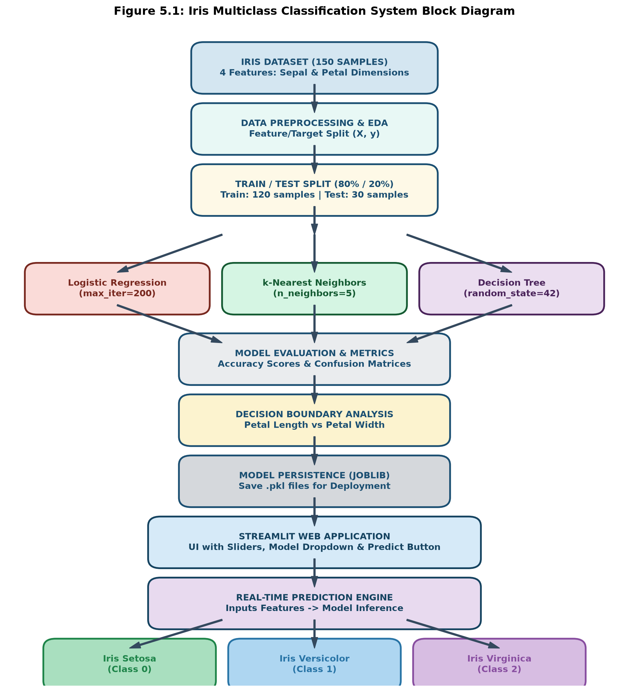
</p>

**Figure 5.1: System Block Diagram**

**Explanation:**
The system begins by loading the Iris dataset from Scikit-learn. The data is organized into input features and target labels and divided into training and testing sets. Three machine-learning models are trained and evaluated. Their performance is compared using accuracy scores and confusion matrices. The trained models are saved using Joblib and loaded into the Streamlit application. Finally, the user provides four flower measurements and selects a model. The selected model processes the input and displays the predicted Iris species.

---

# 6. FLOWCHART

The flowchart explains the step-by-step execution of the Iris classification system, from dataset loading to the final user prediction.

<p align="center">
  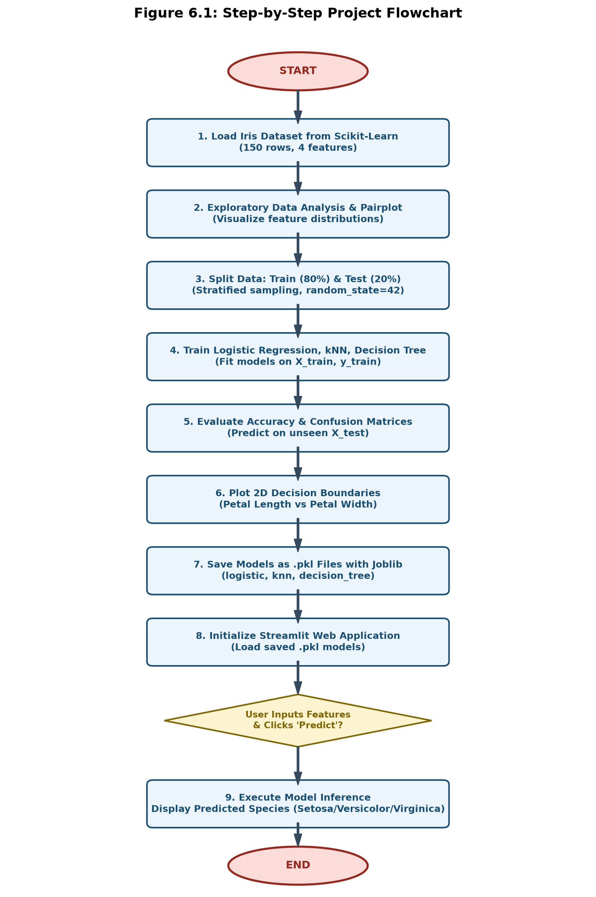
</p>

**Figure 6.1: Project Flowchart**

**Explanation:**
First, the Iris dataset is loaded and its features and target labels are prepared. The dataset is visualized to understand relationships between different measurements. Next, the data is divided into training and testing sets. Three machine-learning algorithms are trained using the training samples. After training, the models are evaluated using the test samples. Accuracy scores, confusion matrices, and decision-boundary plots are generated to compare their performance. The trained models are saved and loaded into the Streamlit application. The user enters four flower measurements, selects a classification model, and clicks the prediction button. The application displays the predicted Iris species.

---

# 7. SCREENSHOTS OF WORKING MODEL

## 7.1 GOOGLE COLAB SETUP AND DATASET LOADING

The project implementation begins in Google Colab. The required Python libraries are imported, including Pandas, NumPy, Matplotlib, Seaborn, and Scikit-learn. The Iris dataset is loaded using the `load_iris()` function.

<p align="center">
  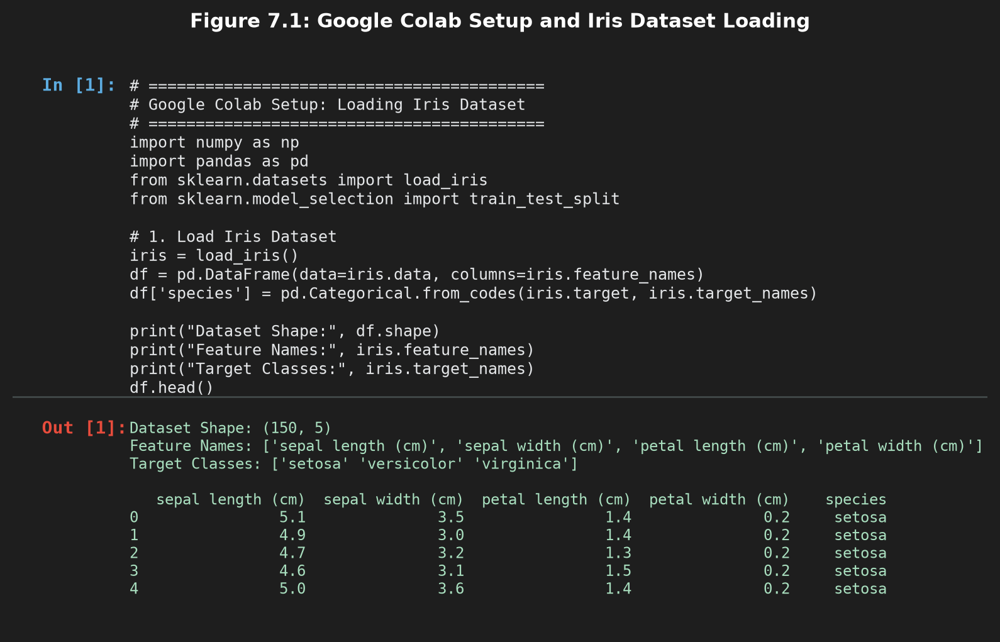
</p>

**Figure 7.1: Google Colab Setup and Iris Dataset Loading**

---

## 7.2 DATASET VISUALIZATION

A pair plot is generated using Seaborn to visualize relationships between all four numerical features. Petal length and petal width provide particularly clear separation between Setosa and the other two species.

<p align="center">
  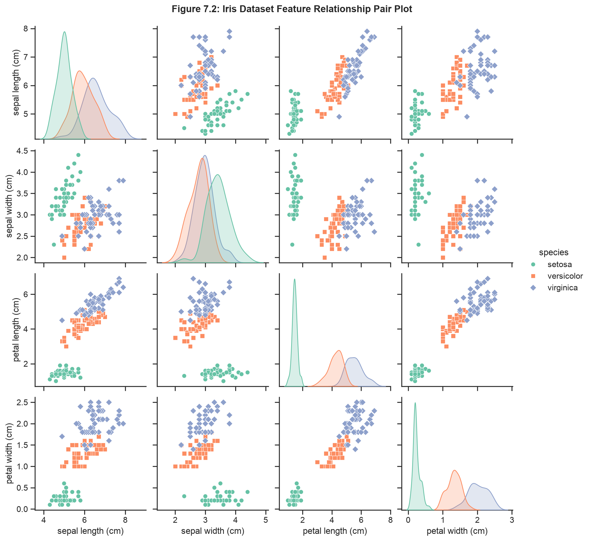
</p>

**Figure 7.2: Iris Dataset Feature Relationship Pair Plot**

---

## 7.3 MODEL TRAINING

The dataset is divided into 120 training samples and 30 testing samples. Three classification models (Logistic Regression, kNN, Decision Tree) are trained and tested.

<p align="center">
  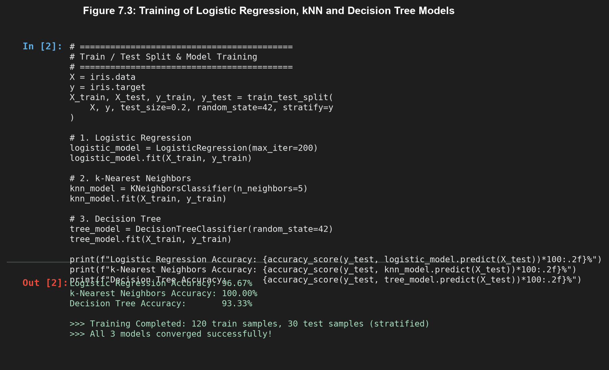
</p>

**Figure 7.3: Training of Logistic Regression, kNN and Decision Tree Models**

---

## 7.4 ACCURACY COMPARISON

A bar chart provides a clear visual comparison of the accuracy scores achieved by all three algorithms on the test dataset.

<p align="center">
  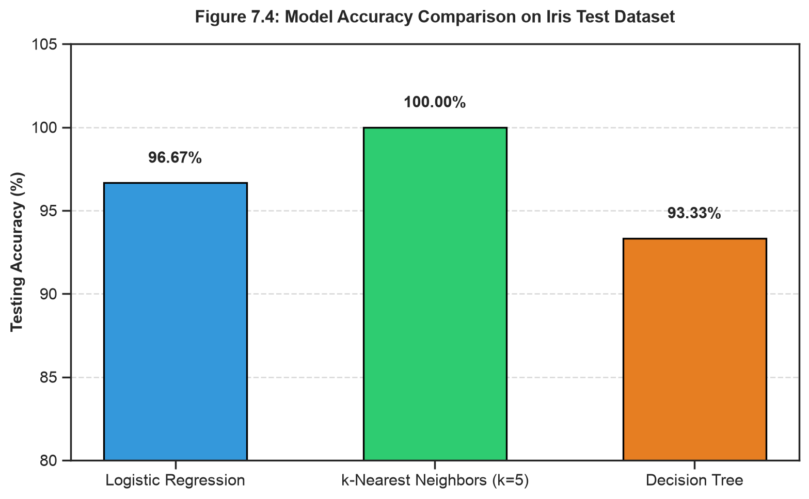
</p>

**Figure 7.4: Model Accuracy Comparison**

---

## 7.5 CONFUSION MATRICES

Confusion matrices compare actual species labels with predicted species labels, illustrating classification precision across classes.

<p align="center">
  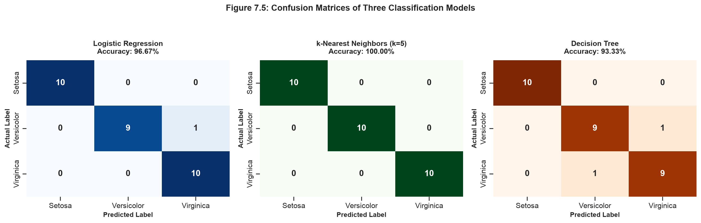
</p>

**Figure 7.5: Confusion Matrices of Three Classification Models**

---

## 7.6 DECISION BOUNDARY VISUALIZATION

Decision boundaries are plotted using Petal Length and Petal Width to illustrate linear boundaries (Logistic Regression), flexible neighbor-based regions (kNN), and rectangular partitions (Decision Tree).

<p align="center">
  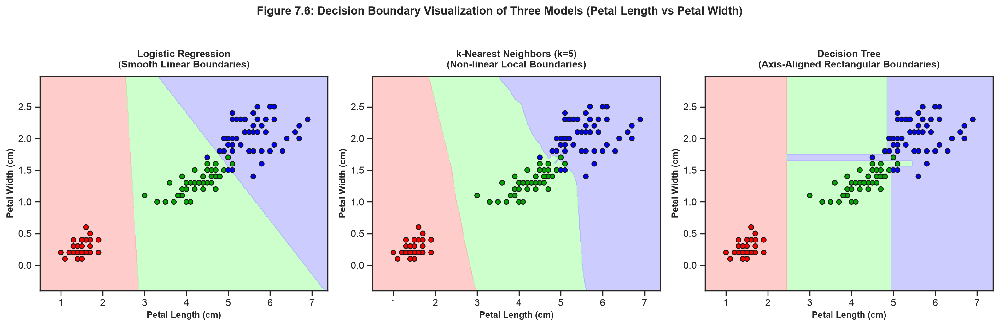
</p>

**Figure 7.6: Decision Boundary Visualization of Three Models**

---

## 7.7 SAVING AND LOADING MODELS

The trained model objects are serialized into `.pkl` files using Joblib: `logistic_model.pkl`, `knn_model.pkl`, and `decision_tree_model.pkl`.

<p align="center">
  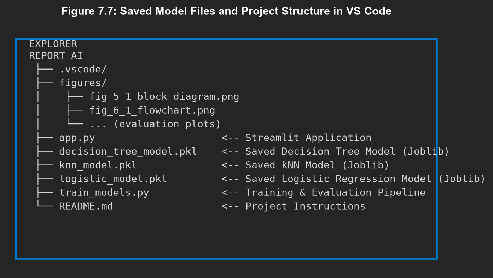
</p>

**Figure 7.7: Saved Model Files in the Project Folder**

---

## 7.8 STREAMLIT APPLICATION

The interactive user interface allows users to input flower measurements through sliders and select a model.

<p align="center">
  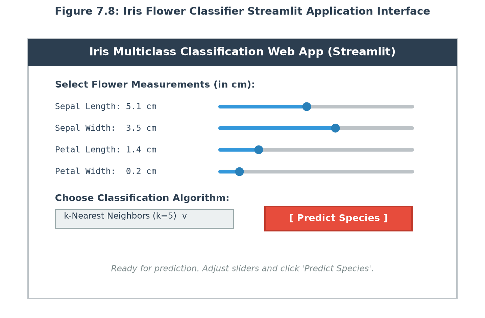
</p>

**Figure 7.8: Iris Flower Classifier Streamlit Application**

---

## 7.9 FINAL PREDICTION OUTPUT

When the user enters measurements (e.g., Sepal Length: 5.1 cm, Sepal Width: 3.5 cm, Petal Length: 1.4 cm, Petal Width: 0.2 cm) and clicks Predict, the model outputs **Iris Setosa**.

<p align="center">
  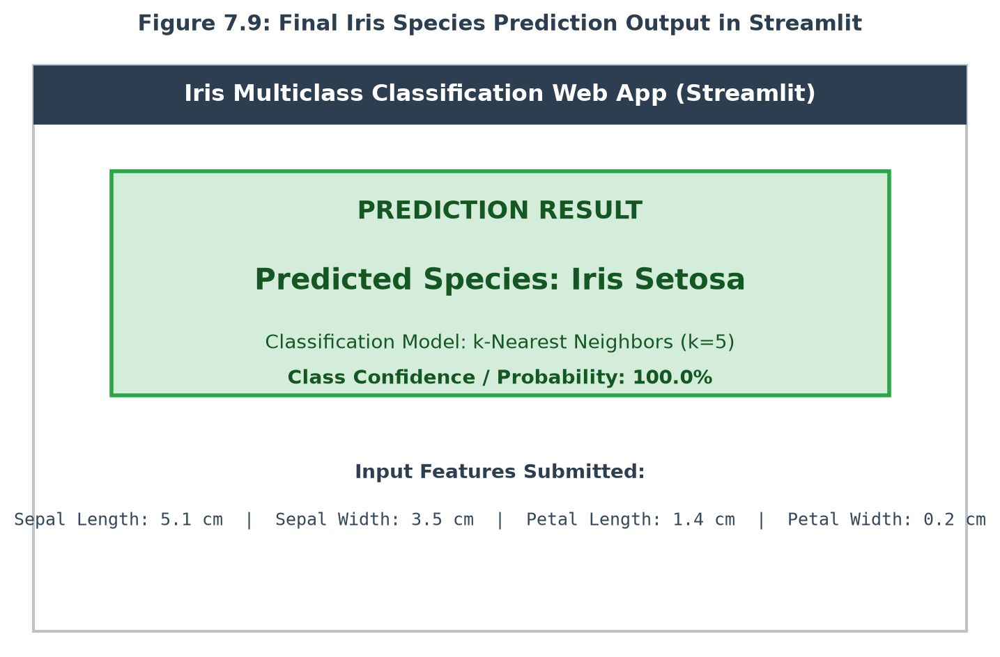
</p>

**Figure 7.9: Final Iris Species Prediction Output**

---

# 8. CONCLUSION

The Iris Multiclass Classification project successfully demonstrates the implementation of a machine-learning classification system using the Iris dataset.

Three supervised machine-learning algorithms—Logistic Regression, k-Nearest Neighbors, and Decision Tree—were trained and evaluated using the same training and testing datasets.

The experimental results showed that kNN achieved the highest accuracy of **100.00%**, followed by Logistic Regression with **96.67%** and Decision Tree with **93.33%** on the selected 30-sample test set.

Confusion matrices were used to examine classification errors, while pair plots and decision-boundary visualizations helped understand the relationships between flower measurements and species separation.

The trained models were saved using Joblib and integrated into a Streamlit application. The application allows users to enter flower measurements, choose a classification algorithm, and obtain the predicted Iris species.

Overall, the project demonstrates the complete machine-learning development process, including data loading, preprocessing, visualization, model training, evaluation, model persistence, and application development.

---

# 9. FUTURE SCOPE

The project can be extended in several ways:

1. **Wine Dataset Extension:** Apply the same classification workflow to the Wine dataset and compare the results.
2. **Model Improvement:** Experiment with different hyperparameters and evaluate performance using cross-validation.
3. **Additional Evaluation:** Include precision, recall, F1-score, and more detailed classification reports.
4. **Application Deployment:** Deploy the Streamlit application online so that it can be accessed by users through a web browser.
5. **Additional Visualizations:** Add probability scores and more detailed prediction explanations to the user interface.
6. **Larger Classification Problems:** Apply the same methodology to other multiclass classification datasets.
